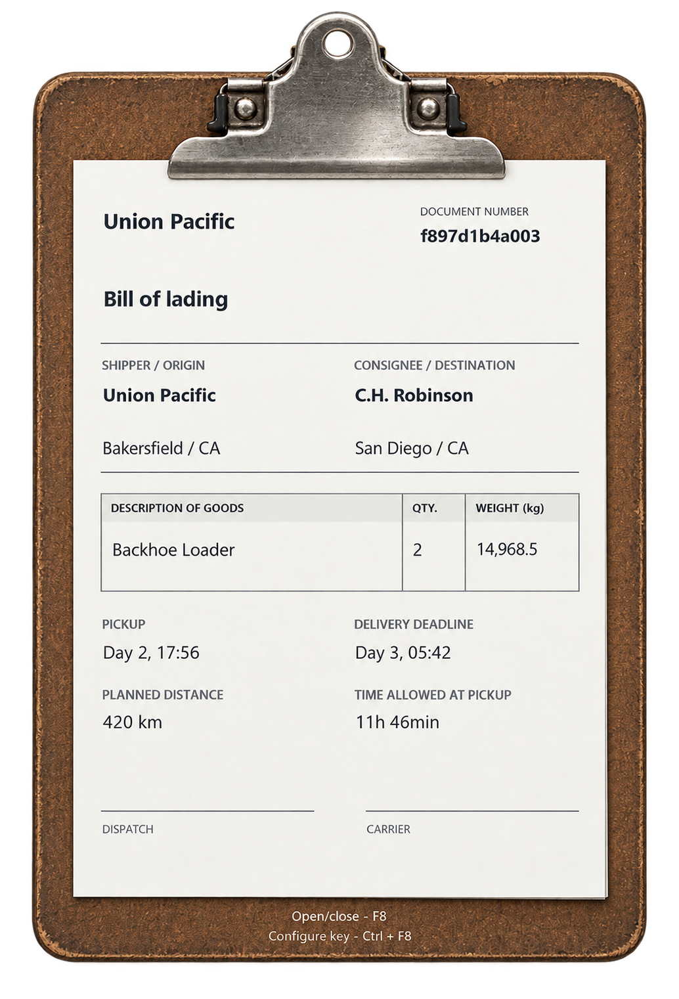
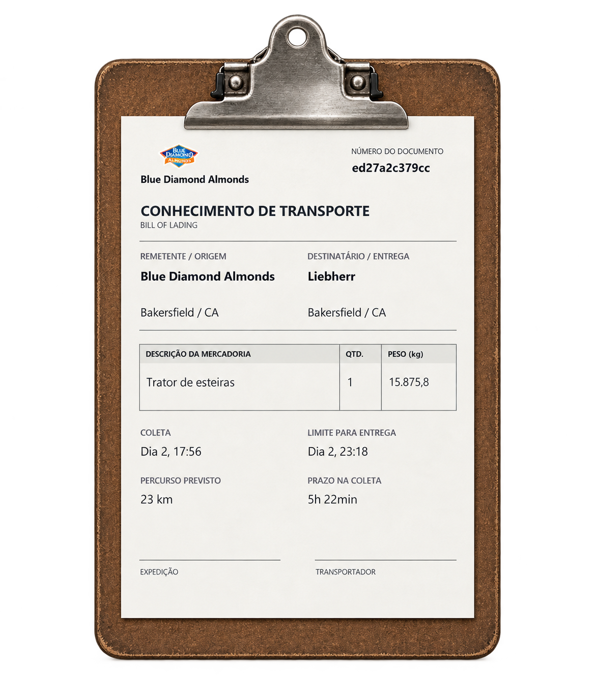

# Cargo Clipboard

[Download v1.0.0](https://github.com/woflymidas-rgb/ats-prancheta/releases/latest) · [English](#english) · [Português](#português)

By / Por [Click Taberna](https://steamcommunity.com/id/clicktaberna/)

## English

Bring a transport document into your cab with **Cargo Clipboard**. Your current job appears on a 2D clipboard, with a paper-style layout and the delivery information in one place.

**Available for American Truck Simulator. A Euro Truck Simulator 2 edition is planned for the future; this release does not support ETS2.**

### Preview

  

The preview shows a setup with a real-company mod. Logos can differ from the base game; that third-party logo pack is not included in this download.

### Features

- Transport document showing pickup and delivery companies, cities/states, cargo, quantity, weight, pickup time, delivery deadline, time allowed at pickup and planned distance, when those details are available.
- Fixed information throughout the trip: the document does not count down or change with the GPS route.
- Automatic opening when a document is issued, with printer and page-flip sound effects.
- Support for Quick Jobs, Freight Market and Cargo Market.
- Separate records for each profile, restored when you return to a saved trip. Reattaching the trailer does not create another document.
- Configurable shortcut, shown on the clipboard frame, and 43 language variants following the game's startup language.
- Starts and exits automatically with ATS. You do not need to run or close a separate app manually.

If the mod first sees a job after pickup, unrecorded pickup details remain unavailable.

### Install

1. Download **ATS-Prancheta-1.0.0-Setup.exe** from [Releases](https://github.com/woflymidas-rgb/ats-prancheta/releases/latest).
2. Close ATS and any older clipboard window, then run the installer.
3. Choose a folder for the clipboard application. It can be outside the game folder.
4. Confirm the folder containing **amtrucks.exe**, usually `American Truck Simulator\bin\win_x64`. The installer tries to find it automatically.
5. Choose whether to create Start menu or desktop shortcuts, finish installation and launch ATS normally.

The **Portable ZIP** is an alternative for manual installation; follow its README.txt. This is not a `.scs` mod and does not need to be enabled in the game's Mod Manager.

### Use

| Action | Default shortcut |
| --- | --- |
| Open / close the clipboard | **F8** |
| Change the shortcut | **Ctrl + F8** |

A newly issued document opens automatically. Your selected shortcut appears on the frame. If another mod uses the same key, choose a different one through Ctrl+F8. To change the document language, change the game language and restart ATS.

### Compatibility and support

Tested on **Windows x64 and ATS 1.61.3.18**. World of Trucks / external contracts, VR and other platforms are not validated. Custom map cities or companies may have missing details or logos.

The project is open source. It works offline, requires no account, and does not change cargo weights, physics or game saves. Component and media credits are in [CREDITOS.txt](CREDITOS.txt).

Report problems through [Issues](https://github.com/woflymidas-rgb/ats-prancheta/issues), including your ATS version, job market and steps to reproduce the issue.

---

## Português

Leve um documento de transporte para a cabine com o **Cargo Clipboard**. O serviço atual aparece em uma prancheta 2D, com aparência de papel e as informações da entrega reunidas em um só lugar.

**Disponível para American Truck Simulator. Uma edição para Euro Truck Simulator 2 está planejada para o futuro; esta versão não oferece suporte ao ETS2.**

### Demonstração

  

A imagem mostra uma instalação com mod de empresas reais. Os logos podem ser diferentes dos encontrados no jogo base; esse pacote de logos de terceiros não está incluído neste download.

### Recursos

- Documento de transporte com empresas de coleta e entrega, cidades/estados, carga, quantidade, peso, horário de coleta, prazo final, tempo disponível na coleta e distância planejada, quando essas informações estiverem disponíveis.
- Informações fixas durante a viagem: o documento não faz contagem regressiva nem muda com a rota do GPS.
- Abertura automática quando um documento é emitido, com efeitos sonoros de impressão e passagem de página.
- Suporte a Trabalho Rápido, Mercado de Frete e Mercado de Carga.
- Registros separados por perfil, recuperados ao retornar a uma viagem salva. Desengatar e reengatar o reboque não cria outro documento.
- Atalho configurável, indicado na borda da prancheta, e 43 variantes de idioma seguindo o idioma de inicialização do jogo.
- Inicia e encerra automaticamente com o ATS. Você não precisa abrir ou fechar outro aplicativo manualmente.

Se o mod identificar um serviço pela primeira vez depois da coleta, os dados de coleta que não foram registrados permanecerão indisponíveis.

### Instalação

1. Baixe **ATS-Prancheta-1.0.0-Setup.exe** em [Releases](https://github.com/woflymidas-rgb/ats-prancheta/releases/latest).
2. Feche o ATS e qualquer janela antiga da prancheta; depois execute o instalador.
3. Escolha uma pasta para o aplicativo da prancheta. Ela pode ficar fora da pasta do jogo.
4. Confirme a pasta que contém **amtrucks.exe**, geralmente `American Truck Simulator\bin\win_x64`. O instalador tenta encontrá-la automaticamente.
5. Escolha se deseja criar atalhos no Menu Iniciar ou na Área de Trabalho, conclua a instalação e abra o ATS normalmente.

O **ZIP Portable** é uma alternativa para instalação manual; siga o README.txt incluído. Este não é um mod `.scs` e não precisa ser ativado no Gerenciador de Mods do jogo.

### Como usar

| Ação | Atalho padrão |
| --- | --- |
| Abrir / fechar a prancheta | **F8** |
| Alterar o atalho | **Ctrl + F8** |

Um documento recém-emitido abre automaticamente. O atalho escolhido aparece na borda. Se outro mod usar a mesma tecla, escolha outra pelo Ctrl+F8. Para mudar o idioma do documento, altere o idioma do jogo e reinicie o ATS.

### Compatibilidade e suporte

Testado em **Windows x64 e ATS 1.61.3.18**. World of Trucks / contratos externos, VR e outros sistemas não foram validados. Cidades ou empresas de mapas personalizados podem ter informações ou logos ausentes.

O projeto tem código aberto. Funciona offline, não exige conta e não altera pesos das cargas, física ou saves do jogo. Os créditos dos componentes e recursos estão em [CREDITOS.txt](CREDITOS.txt).

Relate problemas em [Issues](https://github.com/woflymidas-rgb/ats-prancheta/issues), informando a versão do ATS, o mercado de trabalho utilizado e os passos para reproduzir o problema.
